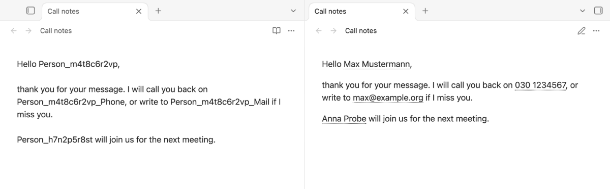
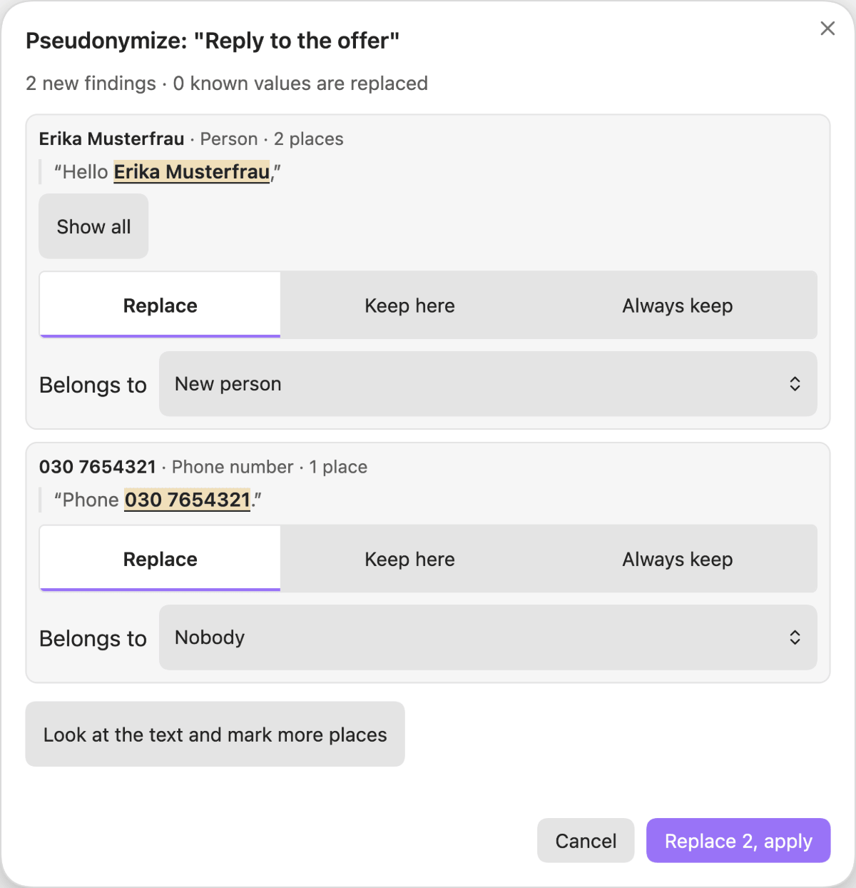
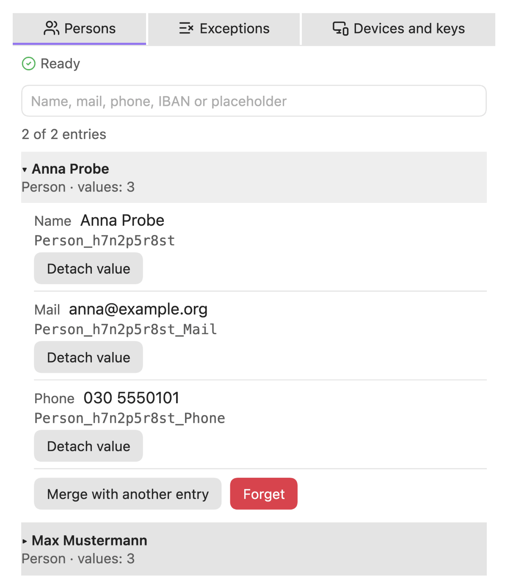
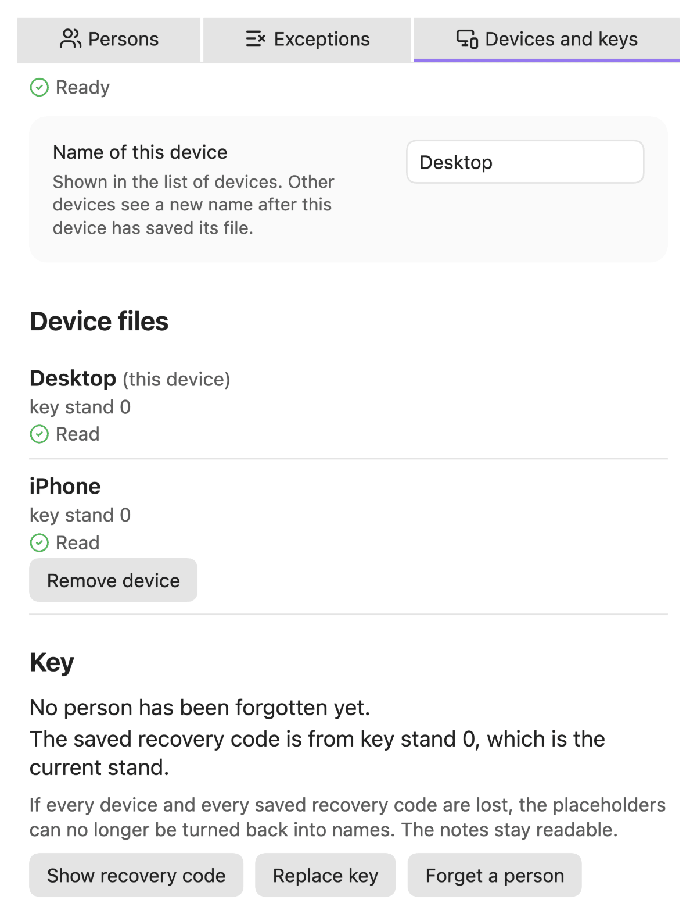

# Pseudonymizer

> [🇬🇧 English](README.md) · 🇩🇪 Deutsch

**Ersetzt personenbezogene Daten in deinen Notizen durch stabile Platzhalter, hält die Zuordnung verschlüsselt in deinem Vault und zeigt beim Lesen den Klartext.**

Agenten mit Dateizugriff, Sync-Dienste, Git-Remotes und Backups sehen deine Notizen als gewöhnliche Dateien. Pseudonymizer ersetzt Namen, Adressen, Telefonnummern und ähnliche Werte in diesen Dateien durch Platzhalter, damit diese Leser Platzhalter und eine verschlüsselte Tabelle sehen statt der Personen. In Obsidian selbst kommt der Klartext beim Lesen zurück.

Das ist Pseudonymisierung, keine Anonymisierung. Das Plugin behauptet nicht, zu anonymisieren, und es ist keine Rechtsberatung.

## Features

- **Stabile Platzhalter** — dieselbe Person trägt überall denselben Platzhalter, Agenten erkennen also weiter, wer wer ist, ohne den Namen zu kennen. Die Daten einer Person (Mail-Adresse, Telefonnummer, Adresse, IBAN) tragen die Kennung dieser Person erst, nachdem du bestätigt hast, dass sie ihr gehören.
- **Verschlüsselte Zuordnung im Vault** — die Tabelle liegt in einem Ordner deines Vaults, eine Datei je Gerät; zwei Geräte überschreiben sich so nie, und ein Sync-Konflikt kann keine Zuordnung verlieren. Der Schlüssel liegt im Schlüsselbund von Obsidian und nie in einer Datei.
- **Klartext beim Lesen** — Lesesicht und Live Preview zeigen statt des Platzhalters den Klartext, und die Datei selbst ändert sich dabei nie. Ein Schalter je Gerät blendet ihn aus. Der Quelltextmodus zeigt Platzhalter.
- **Prüffenster** — neue Fundstellen entscheidest du, bevor etwas geschrieben wird: ersetzen, hier lassen oder immer lassen.
- **Vorhandene Notizen** — eine Auswahl oder eine ganze Notiz samt ihren Text-Eigenschaften pseudonymisieren.
- **Personen und Ausnahmen** — die Tabelle durchsuchen, zwei Einträge zusammenführen, einen falsch zugeordneten Wert abhängen, Texte auf eine Ausnahmeliste setzen.
- **Vergessen** — eine Person lässt sich endgültig vergessen; die Grenzen stehen unten und im Dialog.
- **Plugin-API** — andere Plugins können Text vor dem Versenden pseudonymisieren und danach zurücksetzen.

## Voraussetzungen

- **Obsidian 1.13.0+**, Desktop und Mobil.
- Die Tabelle ist eine Datei mit eigener Endung (`.pseudo`) in deinem Vault, und dein Sync muss Dateien dieses Typs übertragen, sonst sehen deine anderen Geräte die Tabelle nicht. **Mit Obsidian Sync schaltest du auf jedem Gerät unter Einstellungen → Sync im Abschnitt *Selective sync* den Schalter *Sync all other types* (alle anderen Dateitypen) ein** und startest Obsidian neu: Laut Obsidians Hilfe überträgt Sync neben Notizen ab Werk nur Bilder, Audio, Videos und PDFs, und die Einstellung wird nicht zwischen Geräten synchronisiert. Einmal gemessen mit Obsidian Sync vom Mac zum iPhone: Eine `.pseudo`-Datei war nach sechs Tagen nicht am Telefon angekommen, ihr Ordner schon (die Einstellungen der selektiven Synchronisierung wurden nicht gelesen). Dass die Datei mit eingeschalteter Einstellung ankommt, ist **noch nicht gemessen**. Das Plugin kann deinen Sync nicht prüfen und sagt das beim Einrichten.
- Das Plugin macht keine Netzwerk-Anfragen.

## Installation

Das Plugin lässt sich auf drei Wegen installieren.

### Über die Community-Plugins in Obsidian

Sobald das Plugin den Store-Review bestanden hat: **Einstellungen → Community-Plugins → Durchsuchen**, nach *Pseudonymizer* suchen, **Installieren**, **Aktivieren**.

### Von Hand

`main.js`, `manifest.json` und `styles.css` aus dem [neuesten Release](https://github.com/johannes-kaindl/pseudonymizer/releases/latest) laden, in den Ordner `pseudonymizer` im Plugin-Ordner deines Vaults (`<vault>/.obsidian/plugins/`) kopieren und das Plugin unter **Einstellungen → Community-Plugins** aktivieren.

### Mit BRAT

`johannes-kaindl/pseudonymizer` im Plugin BRAT als Beta-Plugin hinzufügen.

## Verwendung

Alles Folgende ist ein Befehl in der Befehlspalette. Jeder Befehl trägt ein Symbol und ist deshalb auch am Telefon erreichbar. Die Beispiele in dieser README nutzen nur erfundene Werte (`Max Mustermann`, `max@example.org`).

**Einrichten.** *Einrichten* erzeugt einen neuen Schlüssel und die erste Gerätedatei in dem Ordner, den du in den Einstellungen gewählt hast. Die Sprache der Platzhalter wählst du einmal für den ganzen Vault (sie nennen ein Feld in dieser Sprache, etwa `Person_k3x9m2ab7q_Telefon` auf Deutsch und `Person_k3x9m2ab7q_Phone` auf Englisch). Dann zeigt das Plugin einmal den **Wiederherstellungs-Code**. Sichere ihn in einem Passwortmanager; das Einrichten geht erst weiter, nachdem du bestätigt hast, dass du ihn gesichert hast. Liegen im Ordner schon Gerätedateien, verweist das Plugin auf *Wiederherstellungs-Code eingeben*, statt neu einzurichten.

**Ein weiteres Gerät.** Das Gerät findet Gerätedateien, aber keinen Schlüssel und meldet *Gesperrt*. *Wiederherstellungs-Code eingeben* nimmt den Code (aus dem Passwortmanager einfügen), prüft das Prüfzeichen gegen Tippfehler, öffnet die Tabelle und schreibt die eigene Datei dieses Geräts. *Wiederherstellungs-Code anzeigen* zeigt den Code auf jedem entsperrten Gerät noch einmal. Ein neues Profil, eine neue Vault-ID oder ein neues Gerät heißt: Code einmal eingeben.

**Klartext zeigen.** *Klartext zeigen umschalten* (und am Desktop der Eintrag in der Statusleiste) schaltet die Anzeige je Gerät um; der Stand wird nicht synchronisiert. Der Klartext erscheint in Lesesicht und Live Preview mit gepunkteter Unterstreichung, und der Tooltip nennt den Platzhalter. Liegt in Live Preview der Cursor oder die Auswahl auf einem Platzhalter, siehst du den Platzhalter.

**Kopieren.** Vorgabe: Kopieren aus der Lesesicht liefert Platzhalter, auch dort, wo Klartext angezeigt wird. In den Einstellungen dreht *Kopieren liefert → Was ich sehe* das um. *Mit Klartext kopieren* und *Mit Platzhaltern kopieren* geben in beiden Fällen die andere Form heraus; sie kopieren die Auswahl im Editor und in der Lesesicht die ganze Notiz. Klartext geht nur hinaus, wenn dieses Gerät jeden Platzhalter des Textes lesen kann; sonst wird nichts kopiert, und eine Meldung nennt die Platzhalter. Vergessene Platzhalter bleiben Platzhalter. Klartext wird nur dort eingesetzt, wo Pseudonymisieren ersetzen würde: ein Platzhalter in einem Link-Ziel, einem Bild oder einer nackten URL, einem HTML-Attribut, einem Kommentar, Mathe, einem Wikilink oder in Code bleibt Platzhalter (sonst könnte eine Markdown-Vorschau im Zielprogramm eine Adresse mit dem Namen abrufen); die Meldung zählt sie.

**Pseudonymisieren.** *Auswahl pseudonymisieren* fragt, was die Auswahl ist und wem sie gehört. *Diese Notiz pseudonymisieren* geht durch den Text und die Text-Eigenschaften und öffnet das Prüffenster: eine Karte je Wert mit *Ersetzen*, *Hier lassen* (nur in dieser Notiz, wird gemerkt) und *Immer lassen* (Ausnahmeliste), dazu *Gehört zu* (eine vorhandene Person, eine neue oder niemand) und ein Weg, weitere Stellen von Hand zu markieren. Abbrechen und Esc schreiben nichts, weder in die Notiz noch in die Tabelle. Die Notiz wird in einem Schritt geschrieben, und nur, wenn sie sich inzwischen nicht geändert hat. Das Plugin legt keinen Schnappschuss an, weil er im Klartext herumläge; der Weg zurück ist Obsidians Rückgängig und der Dateiverlauf. Eine Notiz, die von mailstone kommt, fasst der Befehl nicht an; dafür gilt mailstones eigenes „Neu rendern“.

**Personen und Geräte.** *Personen und Geräte öffnen* hat drei Reiter. *Personen* sucht über jede Form eines Wertes, zeigt Werte und Formen eines Eintrags, führt zwei Einträge zusammen (beide Kennungen lösen weiter auf; diese Version trennt sie nicht wieder), hängt einen Wert ab und startet das Vergessen. *Ausnahmen* ist die Liste der Texte, die nie ersetzt werden. *Geräte und Schlüssel* zeigt den Stand je Gerät, den Stand des gesicherten Wiederherstellungs-Codes und was nach einem Vergessen noch fehlt. *Suchen mit Klarnamen* öffnet Obsidians Suche mit allen Platzhaltern eines Eintrags; der Suchindex selbst bleibt frei von Klartext. *Platzhalter nachschlagen* zeigt, für wen ein Platzhalter steht.

**Person vergessen.** *Person vergessen* fragt nach Bestätigung und listet die Werte, die unlesbar werden, damit du einen Wert, der jemand anderem gehört, vorher abhängen kannst. Dann markiert dieses Gerät die Kennungen des Eintrags als vergessen, entfernt die Werte aus seiner Fassung, dreht den Schlüssel einen Schritt weiter und schreibt seine Gerätedatei neu. Jedes andere Gerät zieht beim nächsten Lesen nach. Wann eine Person vollständig vergessen ist, steht unten.

**Schlüssel ersetzen und Gerät entfernen.** *Schlüssel ersetzen* erzeugt einen neuen zufälligen Schlüssel und schreibt die Fassung dieses Geräts darunter neu; jedes andere Gerät ist gesperrt, bis du dort den neuen Wiederherstellungs-Code eingibst. Das ist die Antwort auf ein verlorenes Gerät, denn Entfernen nimmt einem Gerät den Zugriff nicht weg. *Gerät entfernen* nimmt ein Gerät aus der Liste, das nie mehr nachzieht, nachdem alles Lesbare aus seiner Datei übernommen ist; lässt sich die Datei nicht mehr lesen, ist verloren, was nur dieses Gerät kannte, und der Dialog sagt es.

**Für andere Plugins.** Das Plugin bietet eine Plugin-API v1 (`status`, `transform`, `restore`, `containsPlaceholder`) unter `app.plugins.plugins.pseudonymizer.api`. `transform` kehrt erst zurück, wenn neue Zuordnungen geschrieben sind; es ist alles oder nichts und deterministisch. `restore` ist synchron und meldet Platzhalter, die es nicht auflösen kann (`unknown`), getrennt von vergessenen (`forgotten`); ein Verbraucher, der etwas hinausgibt, behandelt ein nicht leeres `unknown` wie „gesperrt“. Ein `forget` gibt es in Version 1 nicht. Der Vertrag ist die Datei `pseudonymizer-source` in `obsidian-kit`. Ohne Schalter setzt `restore` den Klartext überall zurück, auch in Link-Zielen, Bild-URLs, HTML-Attributen und Code; wohin der Text danach geht, verantwortet das aufrufende Plugin. Mit dem optionalen Feld `skipAddressesAndCode: true` setzt es nur dort zurück, wo `transform` ersetzen würde, in denselben Bereichen wie die eigenen Flächen des Plugins (Lesesicht, Live Preview, die Kopier-Befehle): Platzhalter in Link- und Bildzielen, nackten URLs (auch in HTML-Attributen wie `href`), Code, Kommentaren, Mathe, Einbettungen, Tags und Wikilink-Zielen bleiben stehen (der Alias nach `|` wird zurückgesetzt), das Ziel von `mailto:` wird zurückgesetzt, und im Frontmatter wird jeder Eigenschaftswert einzeln geprüft. Stehen gebliebene Platzhalter zählen weder in `unknown` noch in `forgotten`.

## Was es schützt und was nicht

**Es schützt gegen alle, die nur die Dateien deines Vaults sehen.** Dazu zählen Agenten mit Dateizugriff, der Sync-Dienst, ein Git-Remote, Backups und jede Kopie des Vault-Ordners. Sie sehen Platzhalter und eine verschlüsselte Tabelle.

**Nachdem du eine Person vergessen hast**, kannst auch du den Namen aus älteren Kopien der Tabelle nicht mehr herstellen, sobald alle Geräte nachgezogen haben und der gesicherte Wiederherstellungs-Code erneuert ist.

**Es schützt nicht gegen:**

- Jemanden an deinem entsperrten Obsidian: Die Anzeige zeigt den Klartext, und die Befehle können ihn herausgeben.
- Andere Plugins im selben Obsidian. Der Schlüsselbund ist zwischen Plugins geteilt, und gerenderter Klartext steht in der Seite.
- Einen Agenten, der das laufende Obsidian fernsteuert und den Bildschirm oder die Seite liest.
- Verkettung über die Platzhalter: Dieselbe Person trägt überall denselben Platzhalter, wie oft jemand vorkommt und wer zusammen auftritt, bleibt sichtbar. Die Daten einer Person tragen die Kennung der Person; wer nur die Dateien sieht, erkennt also ohne die Tabelle, welche Adresse, Nummer und Mail-Adresse zusammengehören. Das ist gewollt, und es ist ein Seitenkanal.
- Werte, die ein angebundenes Plugin als Schlüssel behalten muss, etwa Nachrichten-IDs importierter Mails (`mail_id`, `in_reply_to`, `references`); sie bleiben im Klartext und tragen die Domain und teils den Nutzerteil des Absenders.
- Anhänge, PDFs und Bilder: Sie werden nicht erfasst.
- Re-Identifikation aus dem Kontext („die Kassenwartin im Verein X“).
- Was schon im Klartext in deinem Sync-Verlauf, in Git oder in einem Backup lag, bevor du pseudonymisiert hast.
- Reste eines überschriebenen Schlüssels im lokalen Speicher deines Obsidian-Profils, bis dessen Datenbank aufräumt. Einmal am Desktop gemessen: Die alte Fassung blieb dort auffindbar, nicht im Klartext, aber verschlüsselt mit dem Schlüssel deines Benutzerkontos. Auf einem Gerät, das seinen Schlüssel weitergedreht hat, ist deshalb zu erwarten, dass der alte Kettenschlüssel verschlüsselt im Profil liegen bleibt, bis die Datenbank verdichtet wird. Ob sich die alte Fassung mit dem Schlüssel des Kontos wieder lesen lässt, ist nicht gemessen.

### Vergessen: wann es vollständig ist

Vollständig vergessen ist eine Person erst, wenn die Fassung jedes Geräts die Marke trägt, alle Geräte auf demselben Schlüsselstand stehen und der gesicherte Wiederherstellungs-Code durch den aktuellen ersetzt und der alte vernichtet ist. Vorher kann, wer einen alten Schlüssel oder Code und eine alte Kopie der Tabelle hat, den Namen herstellen. Der Dialog und der Reiter *Geräte und Schlüssel* zeigen, was fehlt, etwa wie viele Geräte nachgezogen haben.

Weitere Grenzen des Vergessens:

- Vergessen wirkt auf den Eintrag mit allen Kennungen, die dieses Gerät als zusammengehörig kennt. Haben zwei Geräte dieselbe Person unabhängig angelegt und nicht abgeglichen, bleibt ein zweiter Eintrag mit dem Namen bestehen, bis du auch ihn vergisst. Der Dialog nennt Geräte, deren Fassung noch nicht gelesen werden konnte.
- Ein Gerät, das seinen Schlüssel weitergedreht hat, kann Gerätedateien mit älterem Stand nicht mehr lesen. Was ein anderes Gerät seit dem letzten Abgleich angelegt hat, ist dort erst wieder lesbar, wenn jenes Gerät nachgezogen hat; bis dahin stehen diese Platzhalter als Platzhalter da, und es geht nichts verloren.
- Wird eine Mail vom Server neu gerendert, nachdem der Absender vergessen wurde, kommt der Klartext zurück; das Prüffenster zeigt ihn als neue Person.
- Ein Wert, den du von einer Person abgehängt hast, bleibt ein eigener Eintrag. Der Platzhalter in den Notizen trägt weiter die alte Kennung, und ein Werkzeug, das nur die Dateien liest, sieht weiter die alte Zuordnung. Platzhalter in Notizen umzuschreiben gehört nicht zu Version 1.
- Eine Entscheidung „Hier lassen“ auf einem Gerät, das Bindung und Vergessen-Marke nie zusammen gesehen hat, behält ihren Text, bis alle Geräte nachgezogen haben.

## Konfiguration

Einstellungen → Pseudonymizer. Zuerst die Hilfe, dann der Ordner der Tabelle, das Verhalten beim Kopieren, der Eintrag in der Statusleiste und welche Gruppen von Erkennungsregeln an sind (Muster, Anrede und Gruß, Signaturblöcke, Kopfzeilen im Text, Postadressen). Wähle den Ordner vor dem Einrichten. Ihn später zu ändern verschiebt nichts, und er darf keinen Ordner nutzen, dessen Name mit einem Punkt beginnt.

`data.json` trägt nur Einstellungen, nie einen Namen, einen Wert oder einen Platzhalter im Klartext. Die Ausnahmeliste liegt in der verschlüsselten Tabelle.

## Funktionsweise

Eine Notiz trägt `Hallo Person_k3x9m2ab7q_2, Mail Person_k3x9m2ab7q_Mail`, wo du `Hallo Max, Mail max@example.org` geschrieben hast (die erste Schreibweise eines Namens trägt keinen Zähler, jede weitere einen). Ein Platzhalter hat die Form `<Person|Organisation>_<zehn Zeichen>`, wahlweise gefolgt von einem Feld (`Mail`, `Telefon`, `Adresse`, `IBAN`, in einem englischen Vault `Phone`, `Address`) und einem Zähler ab 2 für eine weitere Schreibweise oder einen weiteren Wert. Die Kennung ist reiner Zufall, deshalb lässt sich ein vergessener Name auch mit dem Schlüssel nicht durch Ausprobieren bestätigen.

Jedes Gerät schreibt die Zuordnung in seine eigene Datei, und jedes Gerät liest die Vereinigung aller Dateien, die es öffnen kann. Einträge kommen nur hinzu; eine Vergessen-Marke gewinnt gegen alles. Die Dateien sind mit AES-256-GCM über WebCrypto versiegelt, mit einem Schlüssel, der bei jedem Vergessen weitergedreht wird. Es gibt keine selbstgebaute Kryptografie: Das Plugin nutzt die gemeinsamen Bausteine des Kits und kein eigenes Verfahren.

Das Erkennen ist regelbasiert und läuft lokal: bekannte Werte, Muster (Mail-Adresse, Telefonnummer, IBAN mit Prüfsumme), Anrede und Gruß, Signaturblöcke, Kopfzeilen im Text und Postadressen (mit niedriger Sicherheit). Überlappende Treffer werden aufgelöst: Der längere gewinnt. In Code, in Link-Zielen, in URLs, in Tags, in Kommentaren und in Formeln wird nichts ersetzt.

### Grenzen

Jede davon ist bekannt und wird nicht verschwiegen.

**Was das Erkennen verfehlt oder falsch macht**

- Ein unbekannter Dritter mitten im Satz ohne Anrede („die Kollegin Schmidt“) wird nicht gemeldet und steht beim unbeaufsichtigten Import im Klartext. Du schließt die Lücke, indem du den Text ansiehst und die Stelle markierst.
- Weitere Grenzen der Regeln: Initialen („J. R. Tolkien“) sind keine Namen; Zeilen mit „An:“, „To:“ und „Cc:“ sind keine Kopfzeilen; eine Straße ohne zusammengesetzte Endung („Am Markt 5“) ist keine Adresse; ein Titel, den die Liste nicht kennt („Dipl.-Ing.“), beendet eine Anrede; die Anrede nimmt höchstens drei Wörter, ein Substantiv hinter einem Namen wird also als Teil davon gelesen. Jede davon ist ein Kandidat, den du von Hand markieren kannst.
- Nachrichten-IDs und Anhänge bleiben, wie oben aufgeführt.
- Ein Wert in einem Wikilink-Ziel (`[[Max Mustermann]]`) bleibt stehen; der Anzeigetext nach `|` wird ersetzt.
- `mailto:`-Links führen nach dem Ersetzen ins Leere: Eine Mail-Adresse wird auch in einem `mailto:`-Ziel und in einem Autolink ersetzt.

**Wo der Klartext nicht angezeigt wird, und wohin er hinausgeht**

- Eigenschaften, Bases, Suche, Dateiliste, Graph und Tab-Titel zeigen Platzhalter. Eine Base über Mail-Notizen zeigt in der Absender-Spalte Platzhalter.
- **Was eingeblendet ist, wird exportiert.** Jeder Renderer, der Obsidians Markdown-Pipeline durchläuft, gibt Klartext aus, solange der Klartext eingeschaltet ist, sonst Platzhalter. Dazu zählen Obsidians eigener PDF-Export (einmal am Desktop gemessen) und Plugins, die Notizen rendern, etwa die Exporter EPUB, Paperize und Letterhead sowie Chat-Blasen. Das Plugin hat keinen eigenen Export. Soll kein Klartext in einen Export, schalte die Anzeige vorher aus.
- Kopieren aus dem Editor in Live Preview: **Ohne Auswahl kopiert CodeMirror die ganze Zeile**, und das ist der Dateitext mit Platzhaltern, auch mit *Was ich sehe*. Mit Auswahl und *Was ich sehe* wird je Stelle ersetzt; unbekannte, vergessene und nicht lesbare Platzhalter und alles in Adressen, Links, Kommentaren, Mathe und Code bleiben Platzhalter (die Bereiche werden über das ganze Dokument gerechnet, Code, der vor der Auswahl beginnt, zählt also mit).
- Zieht man markierten Text aus der Lesesicht heraus, nimmt er den eingeblendeten Klartext mit. Das Plugin setzt die Daten des Zugs wie beim Kopieren, aber das ist **im echten Obsidian noch nicht gemessen**.
- Die Laufzeit in sehr großen Notizen ist **im echten Obsidian noch nicht gemessen**.

**Namen und Notizen**

- Dateinamen: Ein Platzhalter in einem Dateinamen wird nur mit einem Trennzeichen wiedergefunden; der Rückweg macht aus einem Unterstrich neben einer ersetzten Stelle einen Bindestrich, der hergestellte Name ist also nicht byte-gleich (`Rechnung_max@example.org.pdf` wird zu `Rechnung-max@example.org.pdf`). Die Endung wird nie gelesen. Bekannte Werte mit Bindestrich (`Hans-Peter Muster`, `max-muster@example.org`) werden auch im Dateinamen ganz ersetzt; eine noch unbekannte Mail-Adresse liest das Plugin dort gierig: Bindestriche und Unterstriche gehören zu ihrem lokalen Teil, ein Wort davor verschwindet also mit im Platzhalter (`Rechnung-max@example.org.pdf` wird ein Platzhalter für `Rechnung-max@example.org`; zu viel zu ersetzen ist der ungefährliche Fehler). Ein Leerzeichen, eine Klammer, ein Platzhalter oder ein anderer Wert davor (ein bekannter Name, eine Telefonnummer) beenden die Adresse; dieser Wert bleibt ein eigener. Eine bekannte Adresse, eine aus dem Mail-Kopf, eine in `keep` und eine auf der Ausnahmeliste gehen vor und ersetzen nur sich selbst, mit bekannter `max@example.org` behält `hans-max@example.org.pdf` also `hans-` im Klartext.
- „Hier lassen“ hängt am Pfad der Notiz. Wer die Notiz umbenennt, verliert es.
- Eigenschaften: Eine Eigenschaft, deren Wert kein einfacher Text und keine flache Liste ist (verschachtelte Werte, Blockskalare, Fortsetzungszeilen, ein Kommentar im Wert), wird **ausgelassen und in der Meldung mit Namen genannt**, nie umgeschrieben; ihre Zeilen bleiben byte-gleich. Das Plugin behandelt eine Eigenschaft nur als einfach, wenn Obsidians eigenes Lesen (`parseYaml`) des Frontmatter-Blocks des Texts, den es ändert, dasselbe ergibt wie sein Lesen. Datum, Zeit, Wahrheitswerte und `null` gehen nie an das Erkennen.
- Eine Auswahl, die an ein Wortzeichen grenzt oder schon einen Platzhalter enthält, wird abgelehnt.

**Schlüssel, Geräte und Sync**

- **Schlüssel ersetzen bei Sync-Verzug:** Andere Geräte sperren sich über eine Abschlussdatei unter der alten Kette. Die Datei liegt 64 Stände über dem höchsten Stand, den das ersetzende Gerät gelesen hat; ein Gerät, das wegen eines verspäteten Syncs schon bis zu 64 Stände weitergedreht hat, öffnet sie mit seinem Schlüssel und sperrt sich. Erst ein Gerät, das noch weiter vorn liegt, kann die Datei nicht öffnen und bleibt bereit; sein Code wird auf dem ersetzenden Gerät abgelehnt, sobald irgendeine Abschlussdatei dieser Kette im Ordner liegt. Dieser Fall ist hingenommen und nicht geschlossen.
- **Mit Klartext kopieren und das Frontmatter:** Klartext wird nur dort eingesetzt, wo das Plugin auch ersetzen würde. Im Frontmatter wird jeder Eigenschaftswert für sich geprüft: Ein Wert, der eine Adresse (`cover: https://…`), ein Wikilink oder Code ist, behält den Platzhalter; Schlüssel, Listenzeichen, Fortsetzungs- und Kommentarzeilen werden nie zurückgesetzt.
- Ein entferntes Gerät verliert, was nur es kannte, wenn seine Datei nicht mehr lesbar war.
- Vergessen zwei Geräte gleichzeitig, kann ein Gerät noch einmal weiterdrehen müssen; das Plugin tut das selbst.
- Obsidian Sync lässt Dateien mit der Endung `.pseudo` aus, solange *Sync all other types* aus ist (siehe Voraussetzungen); mit eingeschalteter Einstellung ist die Übertragung **noch nicht gemessen**.
- Das Telefon zeigt Klartext wie der Desktop. Einmal an einem iPhone gemessen (iOS 18.7, Obsidian 1.15.1): Obsidians Schlüsselbund behält den Schlüssel über einen Neustart der App, und WebCrypto (AES-GCM, HKDF, HMAC, AES-KW, PBKDF2) ist vorhanden und schnell. Live Preview mit Cursor und Tastatur am Telefon ist **noch nicht gemessen**.
- Gehen alle Geräte und jeder gesicherte Code verloren, lassen sich die Platzhalter nie mehr in Namen zurückverwandeln. Die Notizen bleiben lesbar.

## Dokumentation

- [Dokumentationsindex](https://github.com/johannes-kaindl/pseudonymizer/blob/main/docs/README.md)

## Lizenz

Code: AGPL-3.0-or-later ([LICENSE](LICENSE)). Dokumentation: CC BY-SA 4.0 ([LICENSE-DOCS](LICENSE-DOCS)). Doppellizenz auf Anfrage: [LICENSING.md](LICENSING.md).
