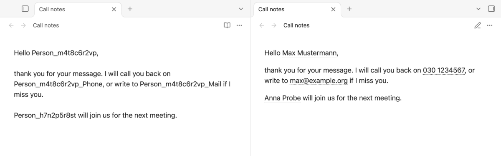
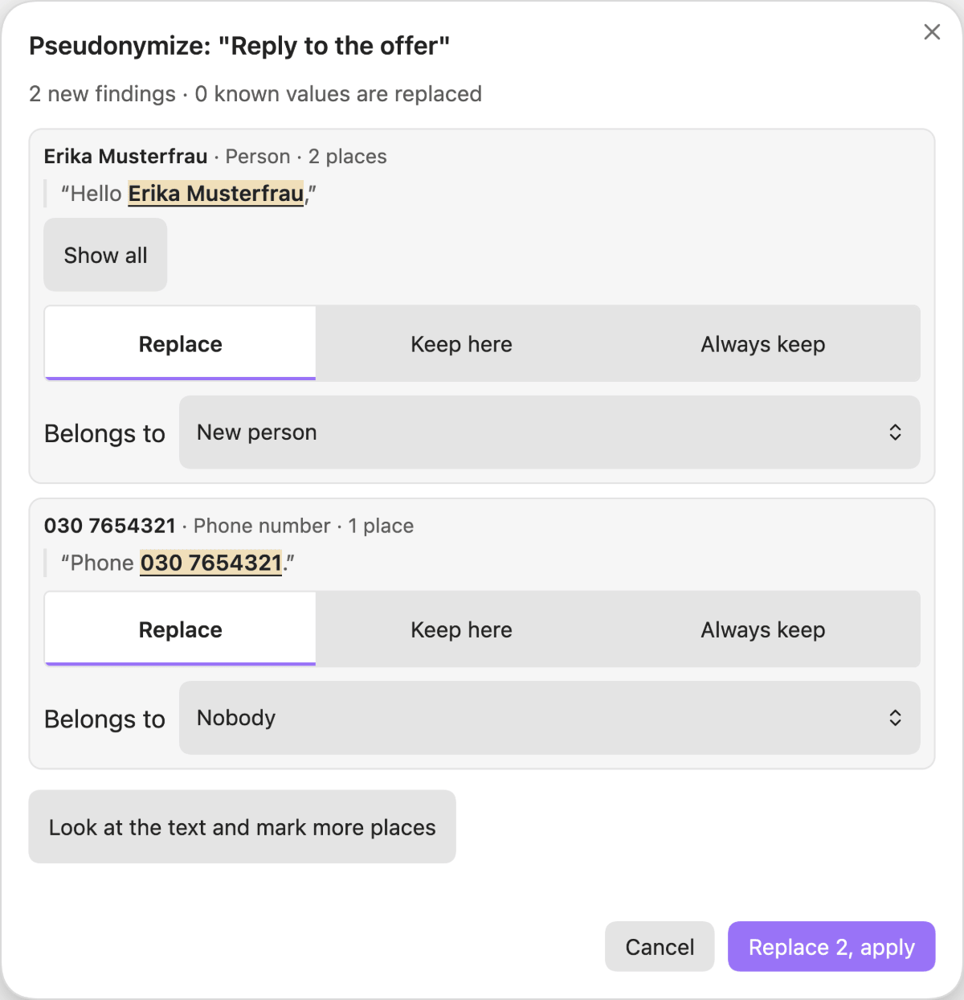
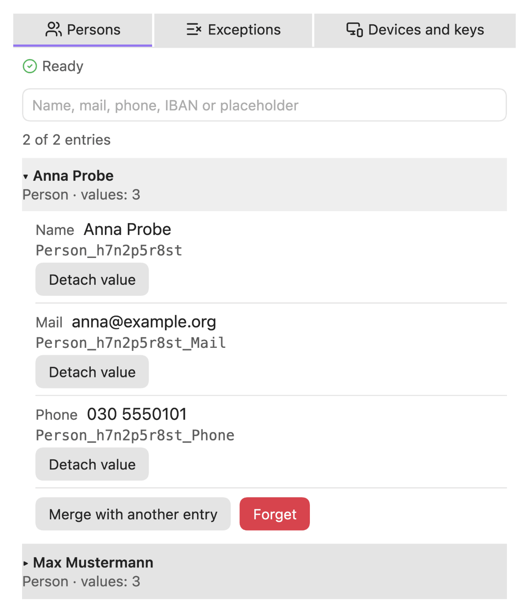
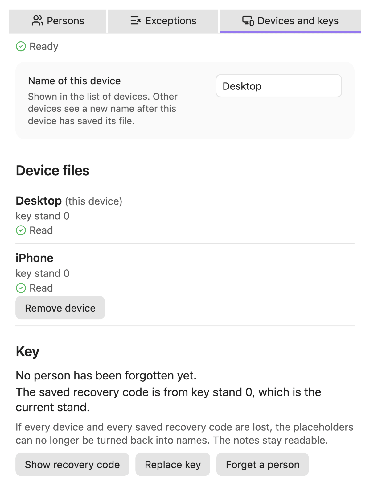

# Pseudonymizer

> 🇬🇧 English · [🇩🇪 Deutsch](README.de.md)

**Replaces personal data in your notes with stable placeholders, keeps the mapping encrypted in your vault and shows the plain text while you read.**

> [!warning]
> Pseudonymizer is under construction and not published yet. There is no release, no tag and no store entry. Nothing in this repository is ready to protect real data.

Agents with file access, sync services, Git remotes and backups see your notes as plain files. Pseudonymizer replaces names, addresses, phone numbers and similar values in those files with placeholders, so that these readers see placeholders and an encrypted table instead of the people. In Obsidian itself the plain text comes back while you read.

This is pseudonymization, not anonymization. The plugin does not claim to anonymize, and it is no legal advice.

## Features

- **Stable placeholders** — the same person carries the same placeholder everywhere, so agents can still recognise who is who without knowing the name. The data of a person (mail address, phone number, address, IBAN) carries the identifier of that person only after you confirmed that it belongs to them.
- **Encrypted mapping in the vault** — the table lives in a folder of your vault, one file per device, so two devices never overwrite each other and a sync conflict cannot lose a mapping. The key lives in Obsidian's secret storage and never in a file.
- **Plain text while reading** — reading view and Live Preview show the plain text in place of the placeholder, and the file itself never changes. A switch per device turns it off. Source mode shows placeholders.
- **Review window** — new findings are decided by you before anything is written: replace, keep here, or always keep.
- **Existing notes** — pseudonymize a selection or a whole note, including its text properties.
- **Persons and exceptions** — search the table, merge two entries, detach a value that was assigned wrongly, keep texts on an exception list.
- **Forgetting** — a person can be forgotten for good; the limits are listed below and in the dialog.
- **Plugin API** — other plugins can pseudonymize text before they send it somewhere and restore it afterwards.

## Requirements

- **Obsidian 1.13.0+**, desktop and mobile.
- The table is a file with its own extension (`.pseudo`) in your vault. Syncing it needs a sync that transfers files of that type. Whether Obsidian Sync does is **not measured yet**; the plugin says so during setup instead of being silently incomplete.
- The plugin makes no network requests.

## Install

There is no release yet. Once version 0.1.0 is out, the plugin can be installed in three ways.

### From Obsidian's Community plugins browser

Once the plugin has passed the store review: **Settings → Community plugins → Browse**, search for *Pseudonymizer*, **Install**, **Enable**.

### Manually

Download `main.js`, `manifest.json` and `styles.css` from the [latest release](https://github.com/johannes-kaindl/pseudonymizer/releases/latest), copy them into the folder `pseudonymizer` inside your vault's plugin folder (`<vault>/.obsidian/plugins/`) and enable the plugin under **Settings → Community plugins**.

### With BRAT

Add `johannes-kaindl/pseudonymizer` as a beta plugin in the BRAT plugin.

## Usage

Everything below is a command in the command palette. Commands carry an icon, so they are reachable on a phone as well. Examples in this README use invented values only (`Max Mustermann`, `max@example.org`).

**Set up.** *Set up* creates a new key and the first device file in the folder you chose in the settings. You choose the language of the placeholders once for the whole vault (they name a field in that language, for example `Person_k3x9m2ab7q_Phone` in English and `Person_k3x9m2ab7q_Telefon` in German). Then the plugin shows the **recovery code** once. Save it in a password manager; setup only goes on after you confirm that you have saved it. If the folder already holds device files, the plugin points you to *Enter recovery code* instead of setting up again.

**A further device.** The device finds device files but no key and reports *Locked*. *Enter recovery code* takes the code (paste it from your password manager), checks the typing check symbol, opens the table and writes this device's own file. *Show recovery code* shows the code again on any unlocked device. A new profile, a new vault ID or a new device means: enter the code once.

**Show plain text.** *Toggle plain text* (and, on desktop, the status bar item) switches the display per device; the state is not synced. The plain text appears in reading view and Live Preview with a dotted underline, and the tooltip names the placeholder. With the cursor or selection on a placeholder in Live Preview, you see the placeholder.

**Copy.** By default, copying from the reading view yields placeholders, also where plain text is shown. In the settings, *Copying gives → What I see* turns that around. *Copy with plain text* and *Copy with placeholders* hand out the other form either way; they copy the selection in the editor and the whole note in the reading view. Plain text only goes out when this device can read every placeholder of the text; otherwise nothing is copied and a notice names the placeholders. Forgotten placeholders stay placeholders. Plain text is put back only where pseudonymizing would replace it: a placeholder in a link target, an image or bare URL, an HTML attribute, a comment, math, a wikilink or code stays a placeholder (otherwise a Markdown preview in the target app could fetch an address that contains the name); the notice counts them.

**Pseudonymize.** *Pseudonymize selection* asks what the selection is and whom it belongs to. *Pseudonymize this note* looks through the text and the text properties and opens the review window: one card per value with *Replace*, *Keep here* (this note only, remembered) and *Always keep* (exception list), plus *Belongs to* (an existing person, a new one or nobody) and a way to mark further places by hand. Cancel and Esc write nothing, neither to the note nor to the table. The note is written in one step, and only if it did not change while you decided. The plugin keeps no snapshot, because that would lie around in plain text; Obsidian's undo and file history are the way back. A note that comes from mailstone is not touched here; use mailstone's own re-render.

**Persons and devices.** *Open persons and devices* has three tabs. *Persons* searches by any form of a value, shows values and forms of an entry, merges two entries (both identifiers keep resolving; this version does not split them again), detaches a value and starts forgetting. *Exceptions* is the list of texts that are never replaced. *Devices and keys* shows the state per device, the state of the saved recovery code and what is still missing after a forgetting. *Search by plain name* opens Obsidian's search with all placeholders of an entry; the search index itself stays free of plain text. *Look up placeholder* shows who a placeholder stands for.

**Forget a person.** *Forget person* asks for confirmation and lists the values that become unreadable, so you can detach a value that belongs to someone else first. Then this device marks the identifiers of the entry as forgotten, removes the values from its version, turns the key one step forward and writes its device file again. Every other device follows the next time it reads. See below for when a person is forgotten completely.

**Replace key and remove device.** *Replace key* creates a new random key and writes this device's version again under it; every other device is locked until you enter the new recovery code there. It is the answer to a lost device, because removing a device does not take its access away. *Remove device* takes a device that never catches up out of the list, after taking over everything readable from its file; if the file cannot be read any more, whatever only that device knew is lost, and the dialog says so.

**For other plugins.** The plugin offers a plugin API v1 (`status`, `transform`, `restore`, `containsPlaceholder`) at `app.plugins.plugins.pseudonymizer.api`. `transform` returns only after new assignments are written; it is all or nothing and deterministic. `restore` is synchronous and reports placeholders it cannot resolve (`unknown`) separately from forgotten ones (`forgotten`); a consumer that sends something out treats a non-empty `unknown` like *locked*. There is no `forget` in version 1. The contract is the file `pseudonymizer-source` in `obsidian-kit`. By default `restore` puts the plain text back everywhere, also in link targets, image URLs, HTML attributes and code; the calling plugin is responsible for where the text goes next. With the optional `skipAddressesAndCode: true` it restores only where `transform` would replace, the same zones as the plugin's own surfaces (reading view, Live Preview, the copy commands): placeholders in link and image targets, bare URLs (also inside HTML attributes such as `href`), code, comments, math, embeds, tags and wikilink targets stay (the alias after `|` is restored), the target of `mailto:` is restored, and in the front matter each property value is checked on its own. Placeholders left standing count neither in `unknown` nor in `forgotten`.

## What it protects and what it does not

**It protects against everyone who sees only the files of your vault.** That includes agents with file access, the sync service, a Git remote, backups and any copy of the vault folder. They see placeholders and an encrypted table.

**After you forget a person**, even you cannot rebuild the name from older copies of the table, once every device has caught up and the saved recovery code has been renewed.

**It does not protect against:**

- Someone at your unlocked Obsidian: the display shows the plain text and the commands can hand it out.
- Other plugins in the same Obsidian. The secret storage is shared between plugins, and rendered plain text is in the page.
- An agent that remote-controls the running Obsidian and reads the screen or the page.
- Linking by placeholder: the same person carries the same placeholder everywhere, so how often someone appears and who appears together stays visible. The data of a person carry the identifier of the person, so anyone who sees only the files can tell without the table which address, number and mail address belong together. That is intended, and it is a side channel.
- Values that a connected plugin has to keep as keys, such as message IDs of imported mail (`mail_id`, `in_reply_to`, `references`); they stay in plain text and carry the domain and sometimes the user part of the sender.
- Attachments, PDFs and images: they are not covered.
- Re-identification from the context ("the treasurer of club X").
- Whatever already sat in plain text in your sync history, in Git or in a backup before you pseudonymized it.
- Traces of an overwritten key in the local storage of your Obsidian profile, until its database cleans up. Measured once on the desktop: the old version stayed findable there, not in plain text but encrypted with the key of your user account. It is therefore to be expected that on a device that turned its key forward, the old chain key can lie encrypted in the profile until the database is compacted. Whether the old version can be read again with that account key was not measured.

### Forgetting: when it is complete

A person is forgotten completely only when the version of every device carries the mark, all devices are on the same key stand, and the saved recovery code has been replaced by the current one and the old one destroyed. Until then, anyone who has an old key or code and an old copy of the table can recover the name. The dialog and the tab *Devices and keys* show what is missing, for example how many devices have caught up.

More limits of forgetting:

- Forgetting acts on the entry with all identifiers this device knows to belong together. If two devices created the same person independently and have not synced, a second entry stays, with the name, until you forget that one as well. The dialog names devices whose version could not be read yet.
- A device that turned its key forward cannot read device files of an older stand any more. What another device created since the last sync is readable there again only after that device has caught up; until then these placeholders stay placeholders, and nothing is lost.
- If a mail is rendered again from the server after the sender was forgotten, the plain text comes back; the review window shows it as a new person.
- A value you detached from a person stays an entry of its own. The placeholder in the notes still carries the old identifier, and a tool that only reads the files still sees the old assignment. Rewriting placeholders in notes is not part of version 1.
- A decision "keep here" that sits on a device which never saw the binding and the forget mark together keeps its text until all devices have caught up.

## Configuration

Settings → Pseudonymizer. Help comes first, then the folder of the table, how copying behaves, the status bar item and which groups of detection rules are on (patterns, salutations and greetings, signature blocks, header lines in the text, postal addresses). Choose the folder before you set up. Changing it later moves nothing, and it must not use a folder whose name starts with a dot.

`data.json` holds settings only, never a name, a value or a placeholder in plain text. The exception list lives in the encrypted table.

## How it works

A note holds `Hello Person_k3x9m2ab7q_2, mail Person_k3x9m2ab7q_Mail` where you wrote `Hello Max, mail max@example.org` (the first spelling of a name carries no counter, each further one does). A placeholder has the form `<Person|Organisation>_<ten characters>`, optionally followed by a field (`Mail`, `Phone`, `Address`, `IBAN`, or `Telefon`, `Adresse` in a German vault) and a counter from 2 for a further spelling or value. The identifier is pure random, so even with the key a forgotten name cannot be confirmed by trying.

The mapping is written by every device into its own file, and every device reads the union of all files it can open. Entries only get added; a forgetting mark wins against everything. The files are sealed with AES-256-GCM through WebCrypto, with a key that is turned forward on every forgetting. No cryptography is hand-rolled: the plugin uses the shared building blocks of the kit and no scheme of its own.

Finding is rule-based and runs locally: known values, patterns (mail address, phone number, IBAN with check digits), salutations and greetings, signature blocks, header lines in the text and postal addresses (with low certainty). Overlapping hits are resolved: the longer one wins. Nothing is replaced in code, in link targets, in URLs, in tags, in comments and in maths.

### Limits

Each of these is known and not hidden.

**What the finding misses or gets wrong**

- A third party in the middle of a sentence without a salutation ("the colleague Schmidt") is not reported and stays in plain text in an unattended import. You close the gap by looking at the text and marking the place.
- Further limits of the rules: initials ("J. R. Tolkien") are not names; lines with "To:", "Cc:" and "An:" are not headers; a street without a compound ending ("Am Markt 5") is not an address; a title the list does not know ("Dipl.-Ing.") ends a salutation; the salutation takes at most three words, so a noun behind a name is read as part of it. Each of these is a candidate you can still mark by hand.
- Message IDs and attachments stay as listed above.
- A value in a wikilink target (`[[Max Mustermann]]`) stays as it is; the display text after `|` is replaced.
- `mailto:` links lead nowhere after the replacement: a mail address is also replaced in a `mailto:` target and in an autolink.

**Where the plain text is not shown, and where it goes out**

- Properties, Bases, search, the file list, the graph and tab titles show placeholders. A Base over mail notes shows placeholders in the sender column.
- **What is shown is exported.** Every renderer that runs Obsidian's Markdown pipeline outputs plain text while the plain text is switched on, otherwise placeholders. That includes Obsidian's own PDF export (measured once on the desktop) and plugins that render notes, such as the EPUB, Paperize and Letterhead exporters and chat bubbles. The plugin has no export of its own. If you do not want plain text in an export, switch the display off first.
- Copying from the editor in Live Preview: **without a selection, CodeMirror copies the whole line**, and that is the file text with placeholders, also with *What I see*. With a selection and *What I see*, every place is replaced one by one; unknown, forgotten and unreadable placeholders and everything in addresses, links, comments, math and code stay placeholders (the places are worked out over the whole document, so code that starts before the selection counts).
- Dragging marked text out of the reading view takes the shown plain text along. The plugin sets the data of the drag like copying does, but that is **not measured in the real Obsidian yet**.
- The runtime in very large notes is **not measured in the real Obsidian yet**.

**Names and notes**

- File names: placeholders in a file name can be found again only with a delimiter; the way back turns an underscore next to a replaced place into a hyphen, so the restored name is not byte-identical (`Rechnung_max@example.org.pdf` becomes `Rechnung-max@example.org.pdf`). The extension is never read. Known values with a hyphen (`Hans-Peter Muster`, `max-muster@example.org`) are replaced as a whole in a file name too; a mail address with a hyphen in its local part that is not known yet is detected there only from the last hyphen on, and the part before stays.
- "Keep here" hangs on the note path. Renaming the note loses it.
- Properties: a property whose value is not plain text or a flat list (nested values, block scalars, continuation lines, a comment in the value) is **left out and reported by name** in the notice, never rewritten; its lines stay byte-equal. The plugin only treats a property as plain when Obsidian's own reading (`parseYaml`) of the front matter block of the text being changed equals what the plugin read. Dates, times, booleans and `null` never go to the finding.
- A selection that touches a word character or already contains a placeholder is refused.

**Keys, devices and sync**

- **Replacing the key and a late sync:** other devices lock themselves through a closing file under the old chain. The file is written 64 stands above the highest stand the replacing device has read, so a device that had already turned forward by up to 64 stands because its sync was late still opens it with its own key and locks itself. Only a device further ahead than that cannot open the file and stays ready; entering its code on the replacing device is refused as soon as any closing file of that chain lies in the folder. This case is accepted and not closed.
- **Copy with plain text and the front matter:** plain text is put back only where the plugin would also replace it. In the front matter every property value is checked on its own: a value that is an address (`cover: https://…`), a wikilink or code keeps its placeholder; keys, list markers, continuation lines and comment lines are never restored.
- A removed device loses whatever only it knew if its file could not be read any more.
- Two devices that forget at the same time may need to turn forward once more; the plugin does that by itself.
- Whether Obsidian Sync transfers files with the extension `.pseudo` is **not measured yet** (measurement still to be done). The plugin cannot check it, and says so during setup.
- Behaviour on the phone is **not measured yet and follows**: the secret storage and WebCrypto on iOS, Live Preview with cursor and keyboard, and the decision whether the phone shows plain text at all.
- If every device and every saved code are lost, the placeholders can never be turned back into names. The notes stay readable.

## Documentation

- [Documentation index](https://github.com/johannes-kaindl/pseudonymizer/blob/main/docs/README.md)

## License

Code: AGPL-3.0-or-later ([LICENSE](LICENSE)). Documentation: CC BY-SA 4.0 ([LICENSE-DOCS](LICENSE-DOCS)). Dual-license option: [LICENSING.md](LICENSING.md).
